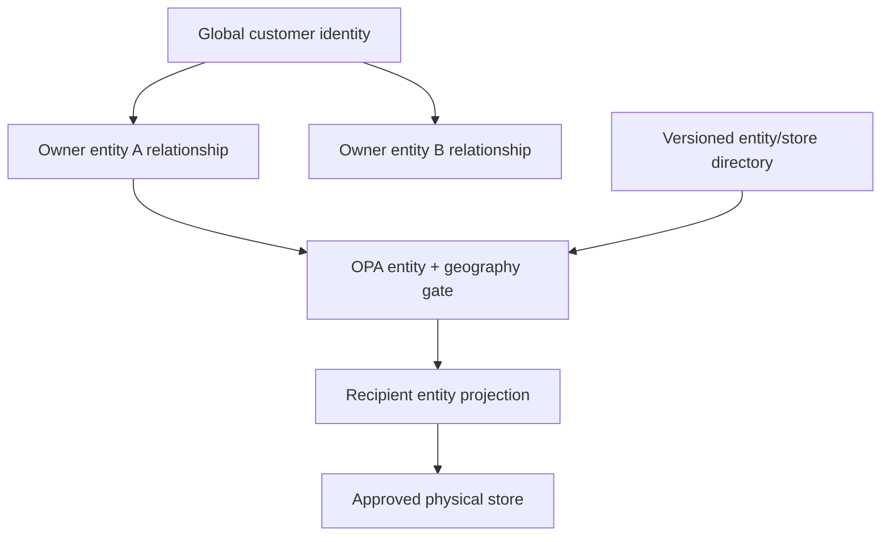
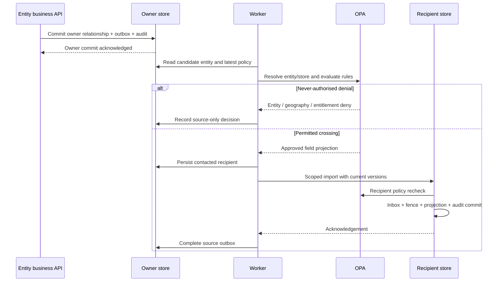
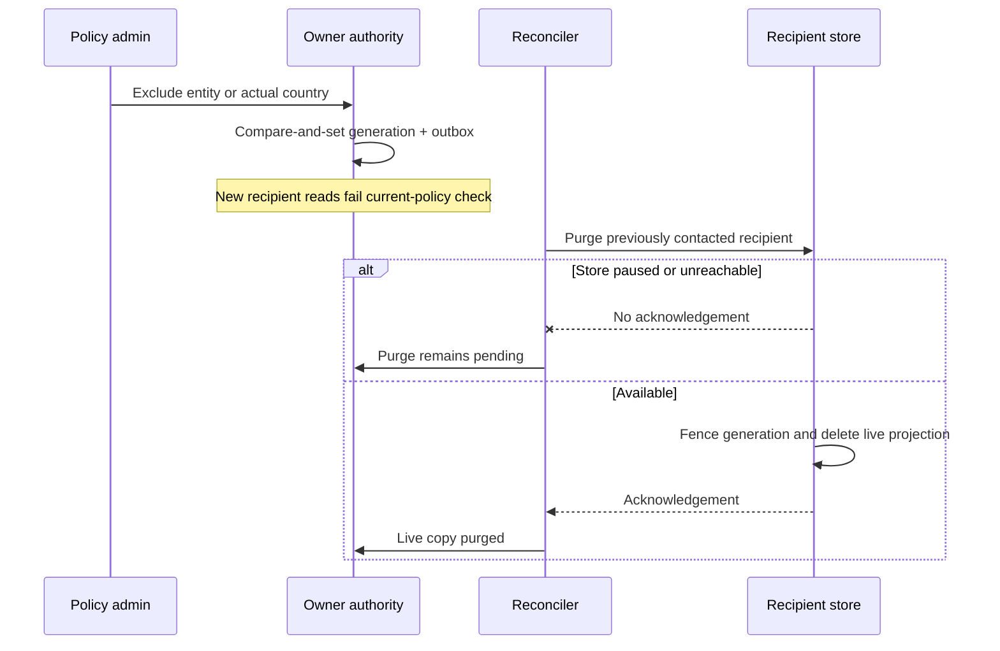
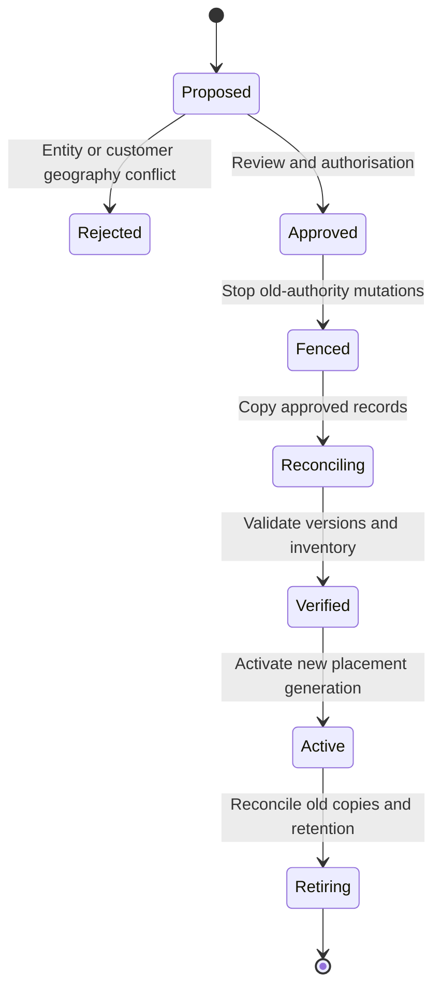

# Scale and pilot extension

Edition 08 adds an isolated, executable [entity relocation slice](MIGRATION.md): Singapore to a fourth Mumbai store, with source-writable copy, catch-up, validation, durable source fencing, India activation and live-copy cleanup. It has a persistent SQLite adapter and optional CockroachDB profile. The original record/normalized-table harness below is unchanged; moving those tables is an explicit adapter extension.

See [scale/SCALE_AND_PILOT.md](scale/SCALE_AND_PILOT.md) for workload assumptions, performance targets, simulations and P01–P24. The scale data path is a proposed evolution; the downloadable operational runtime below is unchanged.

# Operational edition v3

The normalized model, parallel sovereignty layer, global party scope, table/key mapping and service transaction design are in [OPERATIONAL.md](OPERATIONAL.md). The v2 record sandbox described below is retained as a separate flat-record example; its `(owner, global_customer_id)` identity is not the new relationship key.

# Legal entity federation — engineering design v2

The live architecture companion has 21 updated pages, with a prompt on each:
https://customer-federation-design.paulcull.chatgpt.site

## Ownership and placement

Identity does not union rights. Each owner controls its own relationship and its outbound projections. Recipient projections retain source ownership. Same-store recipients use different keys. Three stores support 25 synthetic entity assignments; five country-local policies deliberately have no valid placement.

## Commit and transfer

The diagram combines source/destination OPA into one lane; actual endpoints are separate. The harness holds one process lock. It is not a distributed admission protocol. A production permit must bind owner, customer, recipient entity, physical store, placement generation, policy generation, purpose and profile.

## Revocation and retention

Audit, MVCC, inbox, fences and backups are distinct retained surfaces. No complete erasure claim follows from the live delete.

## Mapping changes

The directory is immutable during a run, fingerprinted against persisted state. `placement-plan` returns eligibility, affected record count and conflicting record IDs. It never moves data. Production progression:

Each transition needs a rollback/failure contract. The PoC only implements proposal analysis; later states are design, not running functionality.

## Engineering prompts

| Component | Task | Acceptance gate |
|---|---|---|
| Entity and identity model | Implement owner/customer masters and owner/customer/recipient projections; add governed matching adapter separately. | Two owners with one global ID retain independent state and grants. |
| Physical placement | Create signed catalog versions and a controlled migration workflow; no unguarded remapping. | Customer US exclusion rejects an otherwise eligible entity move to a US store. |
| OPA | Validate entity, store binding, actual country, purpose, entitlement and fields. | Missing facts, denied geography, invalid binding and expiry fail closed. |
| Business gateways | Authenticate legal-entity scopes and processing location, then route to the correct authoritative store. | Spoofed entity headers and prohibited ingress processing are rejected before payload forwarding. |
| Federation transport | Replace direct adapters with mTLS export/import and regional transport after source admission. | Never-authorised stores have no customer artefacts; uncertain acknowledgements retry idempotently. |
| Concurrency | Replace global lock with per-owner/customer ordering, SQL retries and destination fences. | Concurrent updates and revocations do not resurrect denied data or regress versions. |
| Lifecycle | Implement expiry, narrowing, offline purge and migration barrier evidence. | Access denied, purge pending and retained history remain distinct milestones. |
| Observability | Regional collectors, sanitisation and bounded entity/store dimensions. | No customer payload or IDs in unrestricted traces or global metrics. |
| Audit | Append-only identities, integrity checks and immutable approved export. | Traceability across owner, recipient, physical store and both policy/placement generations. |
| UX | Permission-aware regional views, dirty-form controls, pagination and verified state freshness. | Map dots never imply storage; denied paths never animate as successful transfer. |

## Required local gate

Run the real Compose stack and `poc/tests/integration.py`. Inspect SQL rows in each store, not just the monitor. Then add actual node/OPA failure, source crash after destination commit, stale permit replay and backup restore tests. Only after these pass should the single-process harness be split into regional services or load targets be claimed.
