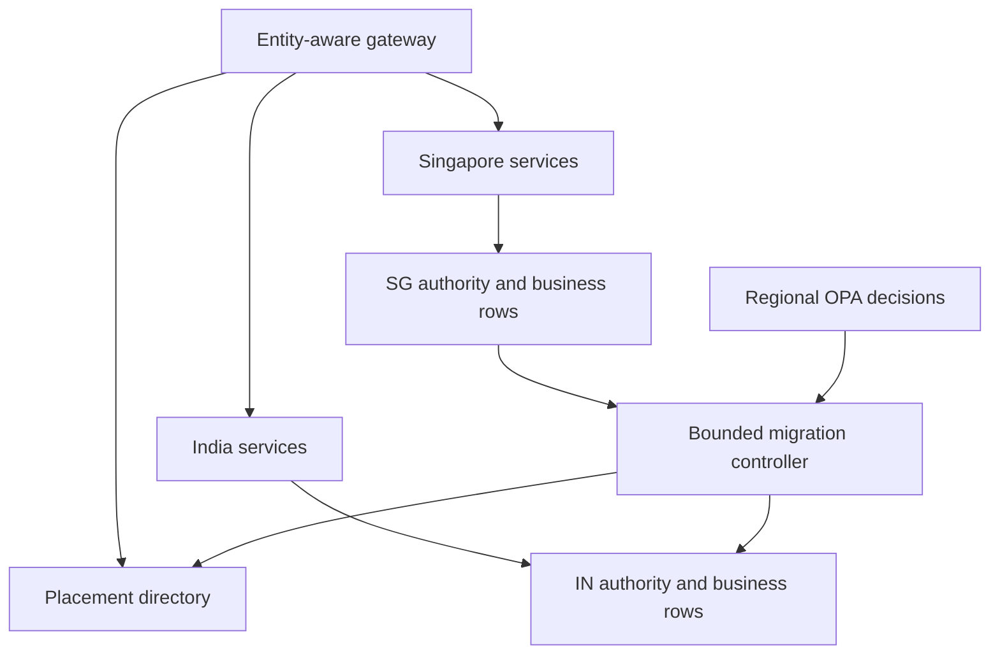

# Entity relocation: Singapore → Mumbai

Edition 08 · 11 October 2026 · synthetic proof of concept

The relocation workspace adds a fourth physical-store model and moves **LE-IN-01** from Singapore to Mumbai while preserving its party, relationship and holding keys. Source operations continue during bounded copy and catch-up. A short, entity-specific write fence precedes the change of authority. Live source cleanup follows separately.

Open the [relocation workspace](/migration.html) or the [component design](/design/entity-migration.html).

## Deployment and scope

The unified development lab runs four independent CockroachDB containers, four OPA decision services, a gateway and one API coordinator. There is no SQLite fallback in either service entry point. Explicit historical SQLite unit adapters remain in source to preserve earlier evidence; they are not the deployment or CockroachDB acceptance suite.

The hosted pages remain clearly labelled browser simulations. Container mode is provided by `/lab-config.json` at the gateway, works on any permitted development hostname and never changes to simulation when dependencies fail.

All stores on a local host have logical country labels; this does not prove physical residency or HA. The original 30-entity catalog and normalized `business.*` examples remain unchanged. Their India-only fixture rejects SG. This isolated `mig_*` scenario explicitly permits SG until simulated t=600, then requires India. The deadline advances only when selected, not with wall-clock time. This is hypothetical policy, not a statement of Indian law.

## Walk through the monitor

1. Click **Auto-copy to validation**. The controller registers Mumbai, checks placement eligibility, captures a consistent source snapshot and copies batches of eight rows. It stops before cutover.
2. Before starting, or during copying, enable **Generate updates while copying**. Holding updates commit at Singapore and enter its local change journal. An unrelated UK workload also commits. Alternatively, add a party/relationship or delete a history row manually.
3. Inspect Singapore/India row versions and pending changes. The target is staging and cannot serve normal business reads or writes. Catch-up carries updates, newly created graphs and tombstones.
4. At **VALIDATED**, compare counts, full contents, versions and parent closure. A new source write invalidates validation and returns the campaign to catch-up.
5. Click **Fence Singapore writer**. Only this entity stops accepting writes. Test **Commit unrelated UK work** while it is fenced.
6. Click **Activate India authority**. The route becomes India at placement v2 / writer epoch 2. **Update holding** now commits at India. Old Singapore requests, old epochs and stale transfer envelopes reject.
7. Repeatedly click **Clean next 8 source rows**. COMPLETE means this fixture's live rows, snapshots, change journal and request receipts have been removed from Singapore. The old writer fence remains. It is not a certificate of physical storage or backup erasure.

Use **Reset synthetic scenario** to start a new demonstration. It clears only this migration's LE-IN-01 namespace; the v3 business/record examples are untouched. In persistent mode, unrelated UK probe commits survive reset. The example is intentionally bounded to 16 relationships / 193 stored row envelopes, including the policy row.

### Failure scenarios

| Action | Expected behaviour |
|---|---|
| Add India exclusion before planning | Plan denied; a country rule and record restriction cannot be bypassed by migration |
| Pause India transport during copy | Transfer rejects; Singapore operations and unrelated UK work remain available |
| Source update after validation | Validation invalidated; catch-up and validation required again |
| Reach deadline before migration completes | SG customer reads, writes and export stop; no invented grace period or automatic fallback |
| Deadline after India cutover | India operations continue; remaining SG copies are explicitly overdue cleanup |
| Old SG writer / stale transfer | Rejected by route, epoch and staging-state checks |
| Cancel before fencing | Remove target staging rows and snapshot; keep lawful SG authority |
| Flip back after fencing or India writes | Rejected; recover forward or engineer a separately authorized reverse migration |
| Restart mid-copy | Resume persisted cursor; replayed versions are harmless |
| Crash after source fence / before India activation | Unavailable for this entity until recovery; never two enabled writers |

“Pause transport” is logical fault injection. Actual database/network termination remains a CockroachDB integration gate. If the deadline expires after fencing but before final source validation, this slice blocks forward transfer as well; production needs an explicitly authorized remediation process. It does not silently relax policy.

## Run the persistent CockroachDB example

From the downloaded lab on a Docker-capable development host:

```bash
./lab doctor
./lab up
# Open http://localhost:8080/migration.html
./lab migration-traffic --count 20 --interval 0.5
# Complete a fresh scenario, or explicitly reset only this synthetic migration:
./lab migrate --reset
./lab test
```

`./lab up` builds the documentation and images, starts all four stores and waits for SQL/OPA readiness. Only the gateway HTTP port is published on host loopback. OPA, SQL and Collector ports stay internal. Named volumes survive `./lab down`. One coordinator process only; synthetic data, insecure SQL and no API authentication. Use an SSH tunnel for a remote development host. See [the deployment guide](docs/DEVELOPMENT.md).

The default API script still supports `--base-url` when run on a workstation. CLI generators inside the container use the local API port. Reloading the container UI preserves database state. Reloading the hosted browser example resets its simulation.

## Architecture and transactions



The diagram describes the service boundary to build. In this slice one FastAPI process stands in for gateway, services and controller; the persistent stores are separate. SQL is never exposed as a client routing interface. A pilot regional gateway authenticates the caller, resolves legal entity to home plus placement epoch, and forwards over private mTLS to the regional business service. The service rechecks authority inside its transaction; gateway caches are hints. A stale route rejects with a bounded retry using the same idempotency key and refreshed directory. Do not retry non-idempotent commands blindly.

```mermaid
sequenceDiagram
    participant C as Controller
    participant S as SG authority
    participant T as India staging
    participant D as Directory
    C->>S: Snapshot plus change sequence
    loop Bounded copy and catch-up
        C->>T: Authorized versioned rows
        S->>S: Business commit plus journal
    end
    C->>T: Validate content and graph closure
    C->>S: Durably fence writer; final sequence
    C->>T: Drain and verify; copy request receipts
    C->>D: Persist IN route, epoch 2, ACTIVATING
    C->>T: Enable epoch 2 writer
    C->>D: Mark ACTIVE
    C->>S: Bounded live cleanup
```

| Boundary | Atomic contents | Recovery rule |
|---|---|---|
| Business command at current home | Writer epoch check; changed business envelopes; per-row versions; local journal; sequence; idempotency receipt | Retry request ID returns original result; conflicting command under the ID rejects |
| Snapshot capture | Consistent owner rows and source sequence, persisted snapshot | Copy cursor is outside that transaction; copying is version-idempotent |
| Target batch | Staging authority check and up to 32 versioned row/tombstone applies | Cursor advances after commit; replay cannot overwrite a newer version |
| Source fence | Durable writable=false and final source sequence | Restart detects fence even if coordinator checkpoint was lost |
| Activate | First persist new route as ACTIVATING, then enable target writer, then mark ACTIVE | No distributed transaction; crash may cause temporary unavailability, not dual writers |
| Cleanup batch | Delete bounded old live rows; final snapshot/journal/receipt cleanup | Repeat safely; retain entity fence; separate retained-storage evidence |

The demonstration keeps its routing/job control row in the SG store, even after India becomes the business-data authority. SG therefore remains an availability dependency of this single-process controller; this is not a source-cell decommissioning test. A pilot needs an appropriately located, resilient directory and regional authority state so eligible India operations do not depend on the retired source service.

One entity lock serializes coordinator changes and this fixture's commands. Other-entity UK commands use an independent lock and regional transaction. This is a safety demonstration, not a distributed consensus implementation or proof of foreground performance isolation. Snapshot capture and final validation scan the bounded fixture; replace them with consistent paged scans and partitioned manifests before scale testing. Source and target clocks are local journal sequences, not globally comparable timestamps.

## Business data and sovereignty stay separate

| Scope | This fixture | Production adapter extension |
|---|---|---|
| Party | Entity-owned party envelope and stable global_party_id | Move entity-private attributes; independently reevaluate global-minimum projections and recipient rights |
| Relationship graph | Relationship, party_relationship and product_holding | Move owner-qualified aggregate; include every parent needed for permitted service reads |
| Servicing data | Contact, consent, preference and history | Retain table, purpose, sensitivity and major-key restrictions; include deletes and retention rules |
| Identifiers/classification | Alternate IDs at party/relationship/holding plus classification | Preserve owner-qualified keys; no cross-entity joins introduced by a shared store |
| Sovereignty | Separate policy envelope plus placement/authority metadata | Separate table policies, key overrides, grants, rule hash, fact revision and placement epoch |

The migration uses typed JSON row envelopes in `mig_rows`, not the v3 normalized schema's SQL foreign keys. Parent closure is checked before activation; staging is not a business-readable graph. For normalized tables, load parents before children, stage chunked aggregates, maintain constraints and expose only complete validated aggregates. Moving the party's India relationship does not move another legal entity's relationship or copy unrestricted contact information globally. The fixture has no outbound recipient grants; pending federation deliveries and incoming projections require a separate ownership-aware handoff adapter.

Keep `legal_entity_id`, `store_id`, `placement_version`, `writer_epoch`, `policy_revision`, `data_version` and migration checkpoint separate. Legal entity identity stays stable when location changes. Do not encode a store ID into a durable party or relationship business key.

## OPA and policy authority

`poc/policies/migration.rego` is a deliberately small Rego policy module. Inputs are constructed from trusted coordinator facts, not arbitrary customer claims. It permits SG reads/writes only inside the transition window, permits authorized transfers to IN only before the deadline, rejects the synthetic IN exclusion, and permits SG purge only after IN becomes home. Other geographies default deny. Registration alone never authorizes serving data. Runtime checks independently require current route, epoch, campaign phase, healthy target and staging state.

```json
{
  "operation": "transfer",
  "country": "IN",
  "elapsed": 0,
  "deadline": 600,
  "conflict": false,
  "home": "SG",
  "target": "IN",
  "phase": "COPYING"
}
```

Pilot extension: intersect legal entity, table, major key, customer restriction, purpose/consent, export and import rules. Deny wins. Use locally distributed signed rule bundles plus scoped authoritative facts; bundle publication alone is not a simultaneous enforcement fence. Separate approved desired placement from active routing and from residual-copy disposal. If no lawful destination exists, block the affected scope and surface the exception.

## API skeleton

| Endpoint | Contract |
|---|---|
| `GET /api/migration` | Synthetic administrative state, phase, counts, row-version diagnostics and recent events |
| `POST /api/migration/register`, `/plan`, `/start` | Register IN; check eligibility; capture source snapshot |
| `POST /api/migration/copy`, `/catchup` | `{ "batch": 8 }`; integer 1–32; checkpointed bulk work |
| `POST /api/migration/validate`, `/fence`, `/activate` | Explicit readiness and authority gates |
| `POST /api/migration/cleanup` | Bounded old live-copy cleanup after activation |
| `POST /api/migration/write` | `{ "kind":"update", "request_id":"unique", "expected_epoch":1 }`; update/create/delete synthetic commands |
| `GET /api/migration/read/SG` or `/IN` | Current authoritative route only; staging/retired denied |
| `POST /api/migration/other` | Independent synthetic UK command |
| `POST /api/migration/pause`, `/deadline`, `/conflict`, `/stale`, `/rollback` | Demonstration faults and pre-fence cancellation |
| `POST /api/migration/reset` | `{ "scenario":"synthetic-india" }`; synthetic namespace only |

Policy/phase conflicts return HTTP 409 in this harness. The administrative monitor is synthetic diagnostic tooling; its counts/version matrix are not a production customer API. It may inspect overdue source metadata to show residual copies. Add authentication, entity-scoped authorization, jurisdiction-aware admin access, optimistic control revisions and asynchronous job resources before pilot. Action endpoints are synchronous bounded demo steps, not a claimed production API standard.

## CDC, performance and observability extension points

The local SQL journal is committed with business changes so a captured snapshot sequence has a continuous change history. For the pilot, prefer a transactional operational outbox with region-local CockroachDB CDC feeding independently budgeted message-bus lanes. Kafka is a suitable durable bus if operationally supported. Authorize projections in-region before cross-border transport; do not export raw customer CDC to a global topic.

CockroachDB changefeeds are at-least-once and do not preserve whole-transaction ordering. A source resolved timestamp is not proof that the recipient applied everything. Retain per-aggregate versions, transaction/manifest boundaries where graph atomicity matters, target-applied checkpoints, tombstones and idempotent receipts. Establish capture before the snapshot and retain history until acknowledged. A snapshot-only copy cannot support concurrent source writes safely.

Migration consumes the capped reconciliation lane. Authority guard and operational deliveries retain separate workers, queues, connection/concurrency budgets and retry paths. Reserve actual IOPS/bytes/CPU as well as worker slots. At pilot scale, shard scans by `(legal_entity_id, table, key-range)`, limit in-flight bytes, persist per-shard cursors and coalesce obsolete desired state without losing mandatory deletions. Throttle bulk when measured foreground p99, lock waits or replication lag breaches its budget. Do not schedule a 100M-relationship scan inside a policy API transaction.

Existing p95/p99 targets remain hypotheses for the pilot, not measured results of this small migration. Initial isolation acceptance: no more than 10% foreground p99 degradation versus the same hardware and arrival workload without bulk movement, while also measuring errors and completion lag. Agree an entity write-pause budget from final-delta and validation measurements; do not promise zero downtime. WAN time, target catch-up capacity, source retention and count/byte skew determine migration duration.

Migration actions emit OpenTelemetry spans with `work.class` = guard / operational / reconciliation. The HTTP component test checks captured span attributes. The retained standalone CockroachDB entry point can export OTLP/HTTP when `OTEL_EXPORTER_OTLP_ENDPOINT` is set; the Compose profile reuses the existing tracer/collector configuration. The unified container acceptance now observes spans in the Collector and trace-correlated application logs in Loki; see [the evidence](docs/CONTAINER_ACCEPTANCE.md). This does not verify every standalone exporter or provide a searchable trace backend. Configure sampling explicitly when diagnosing this small demo. No customer IDs or payloads are used as metric labels.

The monitor's last 60 events are a demonstration log, not immutable audit. Pilot audit should append regional command/decision intents atomically, then relay them idempotently into region-governed append-only storage with retention and access controls. Record job, actor, rule/fact/placement revisions, source/target manifests, applied watermarks, cutover receipts and disposal evidence. Do not send customer payloads into global traces. Add metrics for copy bytes/rows, journal lag, per-shard checkpoints, denied stale writes, pause duration, cleanup age and outstanding backup obligations.

## Tests and remaining pilot gates

```bash
node poc/tests/migration_engine.mjs
python3 poc/tests/migration_test.py
python3 poc/tests/migration_api_test.py
opa test poc/policies
# With a real local OPA process:
python3 poc/tests/migration_test.py http://127.0.0.1:8181
```

Historical edition-08 evidence: browser engine assertions; actual four-file SQLite transactions/restarts; source-fence and target-activation crash gaps; HTTP contracts; OTel in-memory span capture; real OPA decisions with 24 Rego tests including 12 relocation cases. The actual-Opa repository run covers the full movement and fault scenarios. Structural HTML/JS checks are distinct from browser visual QA. See TESTING.md for final verification scope.

Before pilot:

1. Reproduce the passed `./lab test` and live browser walkthrough on pilot hardware. Kill/restart databases and test partitions and migration crash boundaries with actual CockroachDB; the basic acceptance covers API restart and a source OPA outage. Add SERIALIZABLE retry handling and connection pooling.
2. Replace the single coordinator lock with durable campaign ownership/leases and enforce monotonic authority against stale writers at the regional service/store boundary. Test partitions and two competing controllers; no route flip may create two writers.
3. Implement normalized-table adapters, large-graph manifests, incoming recipient projections, pending outbox transfer, audit relay and idempotency-receipt retention/compaction. Preserve original event IDs across authority handoff.
4. Provision lawful local HA, backups, encryption/key custody and regional gateways/services in Mumbai. Validate physical placement for every persistent surface and access path.
5. Run open-arrival foreground load alongside migration at realistic skew; test 50M parties / 100M relationships without treating analytic sizing as a database benchmark. Tune bulk caps to the agreed foreground SLO.
6. Define separate live-purge, MVCC/GC, WAL, backup and archive disposal evidence; exercise deadline-missed exception handling with legal/compliance owners. Hold-sensitive retention may prevent simple destruction and must be resolved explicitly.
7. Conduct browser/accessibility QA, role and approval controls, operational runbooks and a rehearsed reverse migration. After target writes, recover forward unless a fresh lawful reverse campaign is approved and reconciled.

Primary references: [CockroachDB changefeed guarantees](https://docs.cockroachlabs.com/docs/stable/changefeed-messages), [initial scans and cursors](https://docs.cockroachlabs.com/docs/stable/create-changefeed), [OPA bundle distribution](https://www.openpolicyagent.org/docs/management-bundles).
