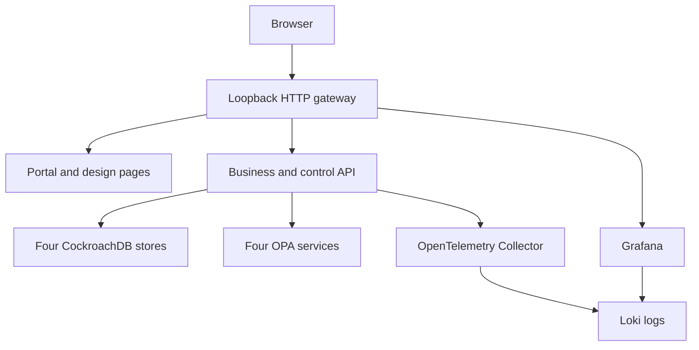

# Development deployment and operations

The entry point is `./lab`. All deployed services use CockroachDB; SQLite is never a runtime fallback. Run on a developer workstation or private development VM with Docker and Compose v2.

For the additive customer MDM system/experience API profile, use
`./lab pilot-up`, `./lab pilot-test` and `./lab pilot-faults`; the operator console
and OpenAPI are on loopback port 8081. See [pilot setup and limits](PILOT.md).
Host Python 3/OpenSSL are additional prerequisites only for generating the
pilot's private synthetic credentials and local CA. The original lab's trusted
operator surface remains separate on port 8080.

## Prerequisites

The database-focused control console is at **http://localhost:8080/clusters/**.
Its cluster health, nodes, recovery rehearsals and durable operation history are
separate from its **Environment** view of supporting services. See
[cluster control](CLUSTER_CONTROL.md) for the live operations and remaining scope.

- Bash; Docker Engine/Desktop; Compose v2 with `up --wait --wait-timeout`.
- Start with 10 GB Docker memory, four CPU cores and 15 GB free disk for the small fixture. This is a practical starting budget, not measured capacity.
- Port 8080 free; copy `.env.example` to `.env` to change LAB_PORT or COMPOSE_PROJECT_NAME.
- Allow image/package downloads for first build. Application flows then stay within Compose networking. OPA telemetry is disabled.
- On Windows, use WSL2/Bash with Docker reachable from that shell.

Images are pinned in Compose/Dockerfiles. Validate bank-approved patches, image digests and licensing before moving beyond a synthetic lab. A pinned tag is not a claim of ongoing vendor support.

Python runtime, scaling and acceptance dependencies are locked with hashes. See
[dependency security](DEPENDENCY_SECURITY.md) for the CVE scan, update procedure,
container evidence and unresolved vendor findings. CI audits actual built images
as well as the Python locks; a successful functional suite does not clear a
failing security gate.

Each CockroachDB node has a 64 MiB cache and a 256 MiB SQL memory budget. The
previous 64 MiB SQL setting could not run the required index backfill: even a
71-row table needed simultaneous bulk buffers exceeding that limit, so startup
kept retrying. The larger budget allows the schema change to proceed on existing
volumes; it does not replace the index or require deleting data. SQL/cache flags
do not cap total container memory. Retain host headroom for the four nodes,
application/OPA processes, telemetry, builds and recovery; the 10 GB starting
allowance is still not a capacity benchmark. See [foundation acceptance](FOUNDATIONS_ACCEPTANCE.md)
for the observed failure and validation of the fix.

## HTTPS proxy and private-umask workspaces

On a host that intercepts package-download HTTPS, keep certificate verification enabled:

```bash
# A PEM bundle containing normal roots and the approved proxy CA; build secret only.
export LAB_BUILD_CA=/path/to/trusted-ca-bundle.pem
./lab up
```

`LAB_BUILD_CA` selects the optional Compose build overlay. The CA is mounted only
for pip installation and is not copied into the image. Internal lab traffic bypasses
the outbound proxy through both `NO_PROXY` and `no_proxy`; the loopback-only gateway
health probe explicitly disables proxy use for its local request.

A workspace extracted with private permissions must make the non-sensitive,
read-only policy/telemetry mounts readable by the image's non-root users:

```bash
find poc/policies infra/grafana -type d -exec chmod a+rx {} +
find poc/policies infra/grafana -type f -exec chmod a+r {} +
chmod a+r poc/otel-collector.yaml infra/loki.yaml
```

The gateway image independently normalizes permissions for its public assets and
live-mode JSON. CockroachDB invokes `/cockroach/cockroach` directly: the pinned
image's initialization wrapper rejects this lab's internal all-interface address.
SQL stays inside Compose networking; only the gateway is published on loopback.

## Commands

| Command | Effect |
|---|---|
| `./lab doctor` | Check Docker, Compose features and resolved configuration |
| `./lab up` | Build docs/images; start and wait for SQL/OPA readiness |
| `./lab status` | Container state and dependency readiness |
| `./lab smoke` | Gateway routes, actual database identities and OPA |
| `./lab faults` | Stop real source OPA/Collector; verify fail-closed export, durable SQL audit and recovery |
| `./lab test` | Engines, Rego, real API/SQL scenarios, migration, restart and OTel receipt |
| `./lab generate --count 5 --scenario sg-uk-no-us` | Add synthetic federation records |
| `./lab business --command open_holding --count 2` | Generate normalized business commands |
| `./lab migration-traffic --kind update --count 20 --interval 0.5` | Generate isolated migration updates |
| `./lab migrate --reset` | Reset only the India fixture and execute its walkthrough |
| `./lab sql SG` | SQL shell; UK, US and IN are also accepted |
| `./lab logs monitor otel-collector` | Follow selected logs |
| `./lab down` | Remove containers/network; preserve volumes |
| `./lab reset --confirm-synthetic-lab` | Delete this project's DB/telemetry volumes |
| `./lab build` | Rebuild portal and validate docs without starting services |
| `./lab release` | Package source ZIP/checksums; Git bundle requires local Git |
| `./lab pilot-up` | Add the authenticated MDM API and recipient peers; loopback gateway 8081 |
| `./lab pilot-test` | Real SQL/OPA system, experience and policy-regression acceptance |
| `./lab pilot-faults` | Actual peer/OPA/Collector outage and restart acceptance; run sequentially |
| `./lab pilot-isolation` | Pause the UK peer and SG OPA in turn; verify unrelated owner reads complete before each timeout |
| `./lab pilot-reconcile --batch-size 10` | Queue bounded current-policy deliveries for persisted protocol evidence; no authority bypass |
| `./lab pilot-identity revoke uk-contact-only` | Revoke a synthetic principal without printing its token; `rotate` reissues it |
| `./lab pilot-down` | Stop pilot and base lab; preserve their volumes |

Tests assume no concurrent manual fixture edits. They restore operational policy changes, add synthetic records, explicitly reset the isolated migration and restart the API. Use a separate COMPOSE_PROJECT_NAME for independent runs.

After an image upgrade, `python3 poc/tests/gateway_dns_acceptance.py` verifies
that the unchanged gateway process follows a real Grafana address change and
restores its original address. Run it separately from the mutable fault suites.
See [observability upgrades](OBSERVABILITY.md#pinned-releases-and-upgrades) for
the Grafana major-version state backup and the current vendor security findings.

## Access and topology



| URL | Purpose |
|---|---|
| `http://localhost:8080/` | Unified portal |
| `/monitor.html#monitor` | Federation monitor |
| `/monitor.html#services` | Business commands |
| `/migration.html` | India relocation |
| `/design/index.html` | Component designs/prompts |
| `/design/adr-register.html` | Architectural decisions |
| `/grafana/d/sovereign-logs` | Searchable application log dashboard |
| `/api-docs` | Executable OpenAPI explorer |
| `/api/health/live` | Process liveness |
| `/api/health/ready` | Actual CockroachDB identity and OPA across four stores |

Only gateway ports are published: 8080 for the base lab and optional 8081 for the pilot, both bound to loopback. SQL/admin UI, OPA and Collector remain internal. The base gateway proxies to a trusted operator harness; the pilot gateway exposes authenticated system/experience contracts. Neither is a deployed regional authorization gateway. For a remote VM with the pilot enabled:

```bash
ssh -L 8080:127.0.0.1:8080 -L 8081:127.0.0.1:8081 user@dev-host
```

The gateway supplies `mode=live,database=cockroach` through `/lab-config.json`; hosted demonstrations explicitly use simulation. No hostname guessing or silent API/database fallback is used.

## Persistence and recovery

Four named database volumes plus local trace, Loki and Grafana volumes survive restart and `./lab down`. The base directory has a persisted catalog fingerprint; changing entity/store assignments on an existing volume is intentionally rejected. Use the isolated migration or a deliberate fresh synthetic environment.

The migration snapshot/journal capture committed changes. Target batches are version-idempotent. SG authority is fenced before India becomes writable. Its SG control row remains a dependency: source-cell decommissioning and distributed directory availability are pilot work. Pre-fence cancellation requires lawful SG placement; deadline expiry never creates an exception.

Browser pause controls are logical fault injection, not process termination.
`./lab faults` stops actual OPA/Collector processes; `./lab pilot-faults` also stops
peers and restarts API/owner/peer processes. These tests preserve SQL volumes and
do not establish database-node failover, regional partitions or backup restoration.
The India fixture does not migrate the normalized MDM or new service tables.

Never restore an old database directly into an active federation network. A
production restore needs external quarantine and current authority/placement
fences before serving, importing or exporting; a quarantine flag stored only in
the restored database can itself roll back. Recovery objectives and retained
storage disposal are explicit gates in [production readiness](PRODUCTION_READINESS.md).

## Troubleshooting

| Symptom | Response |
|---|---|
| Doctor fails | Start Docker, update Compose if needed; no SQLite workaround |
| Pull/build fails | Check network access and image/platform availability |
| Port conflict | Set LAB_PORT in `.env` and run `./lab up` |
| API unhealthy | Inspect `./lab logs monitor` and `docker compose ps`; failures stay explicit |
| Catalog mismatch | Restore original shared/catalog.json or deliberately reset synthetic volumes |
| UI unavailable | Check deployment mode, gateway proxy and `/api/health/ready` |
| Migration step denied | Check phase, deltas, deadline, pause/conflict and writer epoch |
| OTel gate fails | Inspect Collector logs/endpoint; lab sampling is always-on |
| Commit fails under load | Inspect SQLSTATE and the writer's bounded retry/receipt contract; MDM retries do not imply retry coverage for every base operator |
| Startup index backfill retries | Check SQL job/error and node memory settings; use the checked-in 256 MiB SQL budget and preserve volumes rather than dropping the required index |

`docker compose logs --no-color > artifacts/containers.log` captures synthetic diagnostics. Do not capture `pilot-token` output or private identity files. Use synthetic data only: the original operator surface is unauthenticated, SQL remains insecure on a trusted network, and the authenticated pilot shares that host.

## CI and review

The GitHub Actions workflow runs the lab gates and live browser acceptance, collects diagnostics/screenshots and stops containers. The managed development-host run is recorded in [container acceptance](CONTAINER_ACCEPTANCE.md); workflow results must be read from the exact PR commit, not inferred from configuration.

Review the [ADR register](adr/README.md), [documentation audit](DOCUMENTATION_AUDIT.md) and [testing status](../TESTING.md) before pilot planning.

The [production release matrix](PRODUCTION_READINESS.md) separates executable
repository controls from the identity, regional infrastructure, data governance,
recovery objectives and measured capacity evidence a bank must supply. Preserve
the full container gates while evolving the pilot; a static browser model or
historical SQLite unit test is not integration acceptance.

The pilot also starts an independent servicing-case process and bootstraps its
schema/roles inside real CockroachDB. Its [integration contract](SERVICE_INTEGRATION.md)
demonstrates a separate business transaction boundary; service-specific SQL grants
do not establish authentication while the underlying lab SQL transport remains
insecure. See [foundation acceptance](FOUNDATIONS_ACCEPTANCE.md) for executed checks
and the exact remaining blockers.

## Application logging extension

See [observability setup and evidence](OBSERVABILITY.md). `./lab telemetry` verifies API → OTel Collector → Loki, trace correlation and Grafana provisioning. `./lab up` and `./lab test` include this gate. Python OTLP tests passed during authoring. The full Docker/Loki/Grafana path subsequently passed; see [container acceptance](CONTAINER_ACCEPTANCE.md). The starting Docker budget with this extension is 10 GB RAM and 15 GB disk, not measured.
