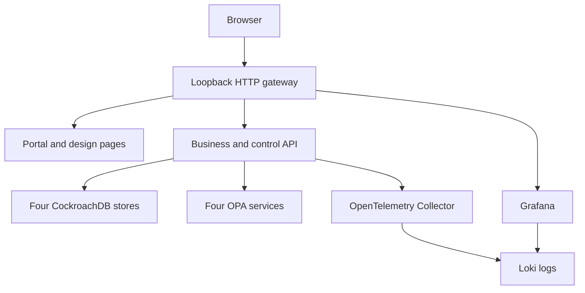

# Development deployment and operations

The entry point is `./lab`. All deployed services use CockroachDB; SQLite is never a runtime fallback. Run on a developer workstation or private development VM with Docker and Compose v2.

## Prerequisites

- Bash; Docker Engine/Desktop; Compose v2 with `up --wait --wait-timeout`.
- Start with 10 GB Docker memory, four CPU cores and 15 GB free disk for the small fixture. This is a practical starting budget, not measured capacity.
- Port 8080 free; copy `.env.example` to `.env` to change LAB_PORT or COMPOSE_PROJECT_NAME.
- Allow image/package downloads for first build. Application flows then stay within Compose networking. OPA telemetry is disabled.
- On Windows, use WSL2/Bash with Docker reachable from that shell.

Images are pinned in Compose/Dockerfiles. Validate bank-approved patches, image digests and licensing before moving beyond a synthetic lab. A pinned tag is not a claim of ongoing vendor support.

## Commands

| Command | Effect |
|---|---|
| `./lab doctor` | Check Docker, Compose features and resolved configuration |
| `./lab up` | Build docs/images; start and wait for SQL/OPA readiness |
| `./lab status` | Container state and dependency readiness |
| `./lab smoke` | Gateway routes, actual database identities and OPA |
| `./lab test` | Engines, Rego, real API/SQL scenarios, migration, restart and OTel receipt |
| `./lab generate --count 5 --scenario sg-uk-no-us` | Add synthetic federation records |
| `./lab business --command open_holding --count 2` | Generate normalized business commands |
| `./lab migration-traffic --kind update --count 20 --interval 0.5` | Generate isolated migration updates |
| `./lab migrate --reset` | Reset only the India fixture and execute its walkthrough |
| `./lab sql SG` | SQL shell; UK, US and IN are also accepted |
| `./lab logs monitor otel-collector` | Follow selected logs |
| `./lab down` | Remove containers/network; preserve volumes |
| `./lab reset --confirm-synthetic-lab` | Delete this project's DB/telemetry volumes |
| `./lab build` | Rebuild portal and validate docs without starting services |
| `./lab release` | Package source ZIP/checksums; Git bundle requires local Git |

Tests assume no concurrent manual fixture edits. They restore operational policy changes, add synthetic records, explicitly reset the isolated migration and restart the API. Use a separate COMPOSE_PROJECT_NAME for independent runs.

## Access and topology



| URL | Purpose |
|---|---|
| `http://localhost:8080/` | Unified portal |
| `/monitor.html#monitor` | Federation monitor |
| `/monitor.html#services` | Business commands |
| `/migration.html` | India relocation |
| `/design/index.html` | Component designs/prompts |
| `/design/adr-register.html` | Architectural decisions |
| `/grafana/d/sovereign-logs` | Searchable application log dashboard |
| `/api-docs` | Executable OpenAPI explorer |
| `/api/health/live` | Process liveness |
| `/api/health/ready` | Actual CockroachDB identity and OPA across four stores |

Only the gateway port is published. SQL/admin UI, OPA and Collector remain internal. The gateway proxies to a single harness; it is not a deployed regional authorization gateway. For a remote VM:

```bash
ssh -L 8080:127.0.0.1:8080 user@dev-host
```

The gateway supplies `mode=live,database=cockroach` through `/lab-config.json`; hosted demonstrations explicitly use simulation. No hostname guessing or silent API/database fallback is used.

## Persistence and recovery

Four named database volumes and one telemetry volume survive restart and `./lab down`. The base directory has a persisted catalog fingerprint; changing entity/store assignments on an existing volume is intentionally rejected. Use the isolated migration or a deliberate fresh synthetic environment.

The migration snapshot/journal capture committed changes. Target batches are version-idempotent. SG authority is fenced before India becomes writable. Its SG control row remains a dependency: source-cell decommissioning and distributed directory availability are pilot work. Pre-fence cancellation requires lawful SG placement; deadline expiry never creates an exception.

Pause controls are logical fault injection, not process termination. The acceptance restart gate restarts the API only. Database/OPA termination and partitions remain additional checks after the basic lab suite passes.

## Troubleshooting

| Symptom | Response |
|---|---|
| Doctor fails | Start Docker, update Compose if needed; no SQLite workaround |
| Pull/build fails | Check network access and image/platform availability |
| Port conflict | Set LAB_PORT in `.env` and run `./lab up` |
| API unhealthy | Inspect `./lab logs monitor` and `docker compose ps`; failures stay explicit |
| Catalog mismatch | Restore original shared/catalog.json or deliberately reset synthetic volumes |
| UI unavailable | Check deployment mode, gateway proxy and `/api/health/ready` |
| Migration step denied | Check phase, deltas, deadline, pause/conflict and writer epoch |
| OTel gate fails | Inspect Collector logs/endpoint; lab sampling is always-on |
| Commit fails under load | Inspect SQLSTATE; SQL retry/pooling are pilot extensions |

`docker compose logs --no-color > artifacts/containers.log` captures synthetic diagnostics. Do not use real bank data in this unauthenticated, insecure development topology.

## CI and review

The GitHub Actions workflow runs the lab gates, collects diagnostics and stops containers when this source is published to a GitHub repository with Actions enabled. It has not run in Sites Git. Retain actual development-host/CI evidence before declaring CockroachDB integration verified.

Review the [ADR register](adr/README.md), [documentation audit](DOCUMENTATION_AUDIT.md) and [testing status](../TESTING.md) before pilot planning.

## Application logging extension

See [observability setup and evidence](OBSERVABILITY.md). `./lab telemetry` verifies API → OTel Collector → Loki, trace correlation and Grafana provisioning. `./lab up` and `./lab test` include this gate. Python OTLP tests passed during authoring; full Docker/Loki/Grafana execution remains unverified. The starting Docker budget with this extension is 10 GB RAM and 15 GB disk, not measured.
