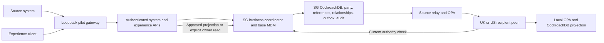

# Runnable customer MDM integration pilot

This is a synthetic, single-host integration pilot. It wires real system and
experience APIs to the operational business model, CockroachDB, OPA and separate
recipient-peer processes. It is not approval to use bank data or a production
regional deployment.

See [executed acceptance evidence](PILOT_ACCEPTANCE.md) for environment, results
and defects found during container validation. The [production release
matrix](PRODUCTION_READINESS.md) maps controls to remaining evidence and bank inputs;
it does not treat a passing synthetic suite as production approval. See
[foundation acceptance](FOUNDATIONS_ACCEPTANCE.md) for the isolation, identity,
protocol and second-service revision's executed results.

## Customer workspace and runtime modes

The modern [customer workspace](MDM_WORKSPACE.md) provides source-qualified search,
customer profiles, relationship/consent views, a guided demonstration and actual
HTTP/trace evidence. Its connection strip distinguishes an explicit read-only
browser preview from authenticated live services and failed/unverified connections.
It never substitutes preview fixtures for a failed live request.

Use `./lab pilot-compact-up` for two independent SG/UK CockroachDB stores, with US,
India, migration and telemetry suspended. Use `./lab pilot-up` to restore the full
four-store lab. Both retain all data volumes and mandatory transactional audit.
Only the full footprint can supply complete US exclusion, migration and telemetry
acceptance; compact is a separate, labelled configuration.

## Start and test

The original lab still runs with `./lab up`. The additive pilot also requires
Python 3 and OpenSSL on the host for private test identities; no host pip packages
are needed for startup. Use Bash/WSL2 and Docker Compose v2. Start with the lab's
10 GB RAM / 15 GB free disk budget; this is a starting allowance, not a benchmark.
The four database nodes use a 256 MiB SQL budget each so required schema/index
backfills have sufficient working memory; see [resource sizing](DEVELOPMENT.md#prerequisites).

```bash
./lab doctor
./lab pilot-up
./lab pilot-test
./lab pilot-faults
# Independently repeat the actual slow-peer/read-isolation regression:
./lab pilot-isolation
# Run the preserved complete lab gates with the pilot profile enabled:
LAB_PILOT=1 ./lab test
# Optional browser walkthrough, with Playwright/Chromium installed:
python3 poc/tests/pilot_browser.py
```

Open **http://localhost:8081/** for the operator console and
**http://localhost:8081/pilot/api-docs** for the typed OpenAPI contract.
The original monitor and Grafana remain on **http://localhost:8080/** and
**http://localhost:8080/grafana/d/sovereign-logs**. `PILOT_PORT` and `LAB_PORT`
override the corresponding loopback bindings. For a private VM, forward both
ports with SSH; no SQL, OPA, peer or Collector port is published.

```bash
ssh -L 8080:127.0.0.1:8080 -L 8081:127.0.0.1:8081 user@dev-host
./lab pilot-token crm-sg
./lab pilot-token uk-servicing
./lab pilot-token us-reader
```

The token commands explicitly print one operator-selected credential. Never
capture them in acceptance logs or use tokens in query parameters. The console
keeps the token only in page memory. Its role-switching controls are for a trusted
synthetic test operator, not a multi-user banking application.

`./lab pilot-down` stops the pilot and underlying lab while preserving volumes.
When the pilot is running, use `LAB_PILOT=1` with ordinary lab commands that
recreate containers, or they will select the original deployment configuration.

## Functional path



Gateway-to-API, API-to-authority, source-to-peer and peer-to-authority connections
verify a private CA and require client certificates. Workload credentials are
separate from client credentials and bound to API or physical-store roles.
The authority TLS proxy forwards to the existing coordinator on the private
Compose network. SQL, local OPA and the original operator interface retain the
development lab's trusted-network/insecure configuration. This is not complete
infrastructure hardening or a physical residency guarantee.

## Base MDM and system APIs

The authoritative party is the existing `business.party` row. `mdm.source_reference`
adds an owner/source-system/reference mapping; it does not create another customer
master. Source references stay in SG. A new party receives a generated stable
global party ID. Matching is exact by registered source reference; fuzzy matching,
cross-source adjudication, survivorship and merge/split stewardship are not implemented.
Relationship context narrows permitted use but cannot override independent party
or shared-attribute restrictions. A global UUID still enables correlation; its
approved geographic footprint is a bank decision. Identity merges must preserve
separate relationship rights rather than union their grants.

The `crm-sg` identity writes only SG-owned synthetic records through these APIs:

| Method / endpoint | Contract |
|---|---|
| `GET /pilot/system/v1/customers` | Owner/source-qualified search (q up to 80 characters), keyset after, limit 1–50; default 25. No recipient enumeration. |
| `PUT /pilot/system/v1/customers/{reference}` | Create at expected version 0 or update an existing version. UUID request ID; `Synthetic ` display name; `PERSON` or `ORGANISATION`. |
| `GET /pilot/system/v1/customers/{reference}` | Owner source reference, party identity and current party-scope version. |
| `POST /pilot/system/v1/customers/{reference}/relationships` | Add a personal-banking relationship, shared contact, consent/preference and scoped bindings. Separate UUID request ID and expected customer version. |

References must use `SYN-` with uppercase letters, digits or hyphens. The seeded
`SYN-ASTER` and `SYN-TRADING` references map to the existing fixture parties.
Each write atomically commits business rows, scope/resource bindings, versions,
outbox intent, mandatory audit with the authenticated actor/request ID, and an idempotent request receipt. Same-input
replay returns the prior result; changed-input replay and stale versions return
409. Bounded serialization retries reuse the request ID. Identity profiles and
party types cannot silently change on an existing reference.

New customers default to `owner_only`. The authenticated synthetic owner can
explicitly choose `global_minimum` or `global_minimum_no_us`. These are fixed test
policy profiles, not inferred legal rights. Relationship profiles are `owner_only`
or `uk_servicing_no_us`; the latter names LE-GB-02 and excludes physical US storage.
Global eligibility never grants relationship access. Arbitrary recipient/country
lists and caller-supplied owner identities are not accepted.

## Experience APIs and routing

| Method / endpoint | Contract |
|---|---|
| `GET /pilot/api/v1/runtime` | Authenticated, observed SQL/OPA/peer readiness and active/suspended footprint; no customer data or credentials. |
| `GET /pilot/api/v1/context` | Authenticated test entity, registered processing country and permitted actions; no customer enumeration. |
| `GET /pilot/experience/v1/customers/{global_party_id}` | Assemble only permitted party/relationship views; omitted relationships have no disclosed denial list or count. |
| `GET /pilot/experience/v1/relationships/{scope_id}` | Approved recipient graph, current authority/placement versions, actual data version and serving source. |
| `POST /pilot/experience/v1/relationships/{scope_id}/commands` | Explicit delegated `update_contact`, `withdraw_consent` or `restore_consent`; route to the SG owner and commit locally. |

Every experience read checks current source policy. Recipient reads also check
local OPA, the projection receipt and current authority/placement revisions.
`freshness=projection` permits ordinary data lag; `minimum_data_version=N` rejects
a projection below the requested version. `freshness=owner` requests the owner's
current **approved field set**, not unrestricted master data. On customer views,
the minimum applies to each included scope; scopes have independent version clocks.
Responses are bounded to 32 KiB and recipient graphs to 50 rows. Point scope reads
load at most 512 bound resources plus bounded relevant consent/classification
facts; customer assembly is limited to 50 scopes. These are rejection limits,
not pagination or a measured capacity guarantee. Larger queries
require a future paginated contract. No nearest-store fallback or writer promotion
is implemented. Unknown required authority or policy fails closed.

Clients cannot override entity, processing country, owner, purpose or peer URL
using headers. `uk-servicing` has LE-GB-02 read/contact/consent delegation;
`uk-contact-only` can update contact information but cannot change consent;
`uk-business` has LE-GB-03 read rights; `us-reader` can receive eligible minimal
party identity but no excluded relationship. `uk-from-us` deliberately represents
a UK entity using a US processing location and is rejected for US-excluded scopes.
These locations and the configured gateway/API/authority processing path are
trusted **synthetic operator claims**, not geolocation or bank IdP assurance.

Processing geography is checked against scope, table and resource rules as well
as the storage decision. A scope is rejected when any approved row cannot be
processed at any registered processing hop or the caller's location. Command
delegation is separate from read permission: `update_contact` requires a grant for
`contact_info.value`, while consent commands require a grant for `consent.status`.
Both API and owner enforce the command grant. Command responses and replays include only
the requested scope's version and safe status; complete affected-scope/history
metadata remains in the owner SQL receipt. Contact updates require an explicit
value; omitted/null values cannot activate the original demo's fallback.

## Movement, races and failures

Only the source-approved rows and recipient-specific policy facts cross the
peer interface. No other recipient grant list, owner display name for a minimal
party, withheld resource, raw source reference or denial explanation is sent.
The recipient verifies current source intent and envelope digest, then its own
OPA before committing graph replacement, manifest, inbox and audit together.
Incoming fields must satisfy the recipient's approved field list before storage.
Reads also enforce the current source-approved field list, including when source
and recipient policy catalogs temporarily differ without a scope-version change.
`sovereignty.field_manifest` records each imported row's exact field names in the
same transaction as its projection, inbox, manifest and audit. Reads preserve
present-null values and omit absent fields. Legacy copies without that metadata
are conservatively treated as the full registered field set until re-imported.
Older data/authority manifests are fenced; duplicate intent delivery is idempotent.

Imports declare protocol version 1 and validate graph size, identities, fields,
facts and revision types before SQL mutation. The recipient atomically records
the exact-envelope digest with its inbox/audit/projection changes; the same event
ID cannot be reused for a changed payload. Source and destination placement
revisions are both monotonic fences. A legacy projection lacking current source
placement evidence fails closed until it is reconciled through ordinary source
and recipient policy admission.

`./lab pilot-up` performs the bounded protocol reconciliation after startup. To
repeat it explicitly for persisted synthetic volumes:

```bash
./lab pilot-reconcile --batch-size 10
```

This pages owner scope keys, records audit with new delivery intents and retains
existing pending work. It does not manufacture recipient receipts, bypass current
policy or establish that every queued delivery has completed. Inspect subsequent
normal delivery and guarded reads. This migration of protocol evidence does not
move ownership or normalized business tables to Mumbai.
See [authority and recovery](AUTHORITY_RECOVERY.md) for consumed-intent renewal,
restriction milestones and external restore-quarantine requirements.

HTTP delivery runs outside the owner coordination lock and outside the business
transaction. Pending intents for one scope/recipient coalesce to the current
authorised state; each business audit and command receipt remains durable, and
restrictions committed beyond the selected cutoff remain queued. This is not
a promise to deliver every intermediate business event. Retry selection rotates
by attempt count without changing creation-time cutoffs, so failed-peer groups
cannot indefinitely hold later healthy-peer work behind the batch limit.
Each store gets at most one failed transport probe per batch; deferred intents
remain retries. The attempt counter counts source processing attempts, including
deferral, rather than claiming that each attempt sent a network request. Contact
and expiry metadata writes touch only their scope, leaving unrelated rules/bindings intact.
Peer loss leaves durable queued/retry work while valid owner writes
and audit remain available. Restricted reads can fail while an old physical copy
still exists. Source policy changes cannot recall already in-flight bytes; current
read guards and versioned replacement/purge protect visibility and convergence.
There is one source relay/coordinator, not a distributed authority lease protocol.
Experience reads load bounded scope snapshots, release the owner coordination
lock before source OPA and recipient HTTP, and revalidate current source policy,
versions, returned fields and graph content before returning. Customer assembly
also revalidates its included scopes. A slow recipient must not hold the owner
writer lock; authority remains synchronous and source loss can still make a
regional projection unavailable. This is not a promise of partition availability
or instantaneous worldwide revocation.

Point reads, admission and relay materialisation use scope/binding lookups rather
than loading every owner business row. Broad base-operator commands, the full
monitor and source-wide outbox selection still have broader work. Expiry handling
scans scope documents. Shared-resource fanout and a production scheduler with
separate authority/foreground/bulk budgets remain unimplemented capacity work.

`./lab pilot-faults` stops actual peer, source/recipient OPA and Collector processes,
then restarts the owner/API/peers and checks durable identity, receipts, projections
and safe log recovery. The existing India migration remains an isolated fixture;
these MDM/normalized tables do not yet migrate to Mumbai.

`./lab pilot-test` also runs `poc/tests/pilot_review_acceptance.py`, which exercises
resource/table processing exclusions, filtered receipts, missing contact values
and temporary real source/recipient OPA field narrowing. It restores modified
catalogs/rules in `finally` blocks. Run it sequentially on synthetic data.

The foundation gates extend `pilot-test` with real SQL/OPA scoped-query,
identity/delegation, import-protocol and independent-service acceptance.
`./lab pilot-isolation` pauses the actual UK peer, starts its experience read,
and requires an unrelated SG owner read to complete below two seconds and before
the failed peer's timeout. It then pauses SG OPA during a delegated command,
requires an owner read below 1.5 seconds, and verifies the denied command wrote no
receipt. `pilot-faults` includes these regressions. These thresholds detect the
demonstrated lock coupling in this fixture; they are not production latency SLOs.

## Independent servicing service

`./lab pilot-up` also starts a separate servicing-case process with its own
CockroachDB schema and service transaction adapter. Open
**http://localhost:8081/service/api-docs** for its contract. The service owns case
interactions; it calls the MDM experience API to validate permitted immutable
party/relationship references and does not import the MDM coordinator or model.
The shared physical SG database host remains a lab convenience, not a shared
business transaction across services.

The adapter commits a case mutation, its version, current-state outbox intent,
uncoalesced transition record, mandatory audit and actor-bound replay receipt in
one local transaction. Create, close and reopen use explicit versions and bounded
SQL serialization retries. An explicit UK refresh passes through the UK peer:
source policy approves a four-field case projection, recipient OPA rechecks it,
and the peer commits projection/inbox/audit together before acknowledging the
applied version. US case access remains excluded.

Use `POST /service/experience/v1/cases/{case_id}/refresh` to materialise the current
approved summary. `GET /service/experience/v1/cases/{case_id}` checks current MDM
and case authority and returns 409 when a refresh is required; it never refreshes
implicitly. There is no second asynchronous background publisher, offline read
lease or delivery of every transition. Separate retained transition records
preserve business history. A denied case read does not remove its old UK copy;
case live-copy cleanup remains a separate unimplemented gate. See
[service integration](SERVICE_INTEGRATION.md) for identities,
endpoints, SQL-role checks and adoption limits. Every writer of an adopting
service still needs the adapter contract or credentials that prevent bypass.

## Credentials, logs and remaining pilot gates

Private identities/certificates live in ignored `.pilot/`, with separate per-role
mounts. They are excluded from Docker contexts and source release archives.
Configuration schema v2 gives principal, workload and importer credentials
`not_before`, `expires_at` and `revoked` controls. Requests and outgoing workload
calls reload the private configuration so local token revocation/rotation takes
effect without a process restart. Credential expiry cannot exceed the relevant
TLS certificate expiry. Certificates expire after 14 days; the CA after 30.

```bash
# These commands update private configuration and do not print credentials.
./lab pilot-identity revoke uk-contact-only
./lab pilot-identity rotate uk-contact-only
./lab pilot-identity revoke-workload peer-uk
./lab pilot-identity rotate-workload peer-uk
# The independent case export has a separate workload credential:
./lab pilot-identity rotate-workload case-export-uk
# Explicitly print a selected new token only when needed by the trusted operator:
./lab pilot-token uk-contact-only
```

Token rotation is a synthetic operator control. TLS certificate rotation still
requires deliberate replacement and process restart; there is no external IdP,
issuer/JWKS validation or managed workload issuance. For certificate reissue,
stop the pilot and move the private identity directory outside the checkout
before fresh setup. Existing supported private layouts upgrade without silently
replacing tokens/certificates; unknown layouts fail for operator review.
The registered synthetic topology fixes API/owner/authority/servicing processing
to SG and peer processing to its SG/GB/US store. Hot changes to role, store,
processing deployment or dependency endpoint fail closed; rotating a credential
is not permission to relocate a workload. These registrations remain operator
configuration rather than attested physical geography.
`PILOT_ENVIRONMENT=production` and a non-synthetic configuration refuse startup;
there is no bank production profile concealed behind that setting.
The trusted operator can access infrastructure and private keys; this is not a
hostile multi-tenant host.

API/peer application events use the existing payload-free OTel pipeline. Search
`{service_name="sovereign-pilot-api"}` in Grafana. Logs contain route templates,
bounded status/duration and locally generated trace IDs, not credentials, request
bodies, raw URLs, customer keys or exception messages. Local trace evidence and
Collector export are diagnostic only; export failure cannot replace or undo SQL audit.

Before a bank pilot: approved data/processing matrix and scope; real identity and
delegation; private regional infrastructure with SQL TLS/scoped credentials;
signed policy readiness and authority/fencing failure contracts; normalized-table
migration; matching/stewardship governance; pagination/indexing and measured load;
retention, restore and operator-access drills; operational/security sign-off.
No HA, 100M-record performance, physical residency compliance or backup-erasure
claim follows from this single-host integration pilot. The required responsible
disciplines, evidence and measurable acceptance are recorded in the
[production release matrix](PRODUCTION_READINESS.md).
