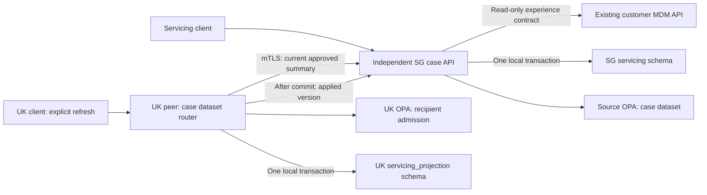

# Integrating an existing business service

The independent servicing-case example demonstrates how a service can retain its
own business schema, transaction and API while adopting a small sovereignty
contract. It consumes the customer MDM experience API; it does not import the
MDM coordinator, rewrite MDM business tables or acquire MDM command permission.
All records are synthetic. The deployment remains one host with trusted local
SQL/OPA infrastructure, not an approved bank environment.

## Business responsibility and sovereignty responsibility

The case service owns `CONTACT_REVIEW` and `DOCUMENT_REVIEW` cases and their
`OPEN`/`CLOSED` state transitions. The MDM owns party and relationship identity.
The case service records an immutable association consisting of the MDM owner,
global party ID and relationship scope ID after an authorised MDM read. A party
identifier alone cannot establish relationship rights.

The case dataset has its own OPA contract. Its fixed synthetic policy permits SG
owner operations and a four-field summary for LE-GB-02, subject also to a current
authorised MDM relationship view. Both policies must permit the export. The
case grant is not inferred from the global party profile, and US access is denied.
Only `case_id`, `status`, `category` and `data_version` cross to the UK case
projection. The MDM association and source business records remain in SG.



The source service uses a dedicated MDM reader, not the owner command credential.
The UK export check uses a separate read-only MDM identity representing LE-GB-02.
Operator identities have explicit case actions; a case reader cannot close or
reopen a case. Unknown, revoked or expired credentials fail closed. The original
MDM, relationship monitor and migrations continue to use their existing model.

## The small local transaction contract

`poc/service_adapter.py` receives a service-owned SQL connection, a fixed schema,
an aggregate identity and a callback implementing the business change. For each
successful command, the same CockroachDB transaction commits:

1. The business row and its new aggregate version.
2. A payload-free `current_state` outbox intent.
3. A separate transition-ledger entry that is never coalesced.
4. Mandatory audit, including authenticated actor, request ID and the observed
   policy/MDM revisions.
5. An actor-qualified idempotency receipt containing the result.

OPA and MDM calls occur before each SQL attempt, never inside the mutation
callback or SQL transaction. CockroachDB serialization conflicts get at most
three attempts, with fresh authorisation on each attempt. Expected versions,
actor, owner, operation and input are part of the receipt fingerprint. A replay
with changed input returns 409; a matching replay returns the committed result.
The command reads and checks current business state inside the same transaction
that advances the version. The adapter does not use a process-wide business lock.

Audit insertion failure rolls back the business row, version, outbox, transition
and receipt together. Telemetry has no role in this commit decision. Application
logs contain the existing approved event fields and route templates, never case
IDs, MDM association IDs, request bodies, credentials or raw URLs.

Authorisation before a local transaction is an observation, not a distributed
atomic commit with another service's policy. This example provides no claim of
instantaneous worldwide revocation, cached authority leases or writer migration.
Read/import checks consult current source authority; a production system still
needs an agreed restriction acknowledgement and in-flight processing contract.

## Current-state projections and business transitions

The case example deliberately uses an explicit refresh operation:

- `POST /service/experience/v1/cases/{case_id}/refresh` requests the current
  source-approved summary, validates recipient OPA, and commits the UK projection,
  inbox and import audit together. Only then does it acknowledge the applied
  version to the source. Duplicate refreshes are idempotent.
- `GET /service/experience/v1/cases/{case_id}` checks current source and recipient
  policy and compares the committed projection with the current approved version
  and field set. It returns 409 when an explicit refresh is required; it never
  silently refreshes or serves an owner fallback.

A source acknowledgement is a monotonic per-case recipient watermark. Intents
at or below that version have been acknowledged; later intents remain pending.
The owner response exposes `delivery.mode=explicit_recipient_refresh` and
`pending_intents`. There is no background publisher. The watermark avoids an
unbounded update of historical intents during acknowledgement. If the UK commit
succeeds but acknowledgement fails, the source remains pending until a retry.

The recipient can move directly from version 1 to version 4. The source still
retains all four transition and audit entries. A workflow that must process each
close/reopen needs its own transition-consumer protocol, ordering, receipts and
retention; this example does not deliver that stream. Outbox/audit retention,
case live-copy cleanup after revocation and recovery after restore are remaining
work. An existing UK copy is denied on reads when current admission is unavailable
or withdrawn, even while physical cleanup remains pending.

## Run and inspect

The case service is part of the additive pilot profile. Startup provisions only
the new schemas/roles before starting the source service and UK dataset router.

```bash
./lab doctor
./lab pilot-up
./lab pilot-test
./lab pilot-token case-owner
./lab pilot-token case-reader
./lab pilot-token case-uk-reader
```

The gateway is loopback-only. Open **http://localhost:8081/service/api-docs** for
the independent business service contract. Use a bearer credential from the
explicit token command; never put credentials in query parameters or saved
acceptance logs. The service endpoints are:

| Method and route | Business contract |
|---|---|
| `POST /service/system/v1/cases` | Explicit case UUID, request UUID, expected version 0, existing global party/relationship IDs and enum category. |
| `GET /service/system/v1/cases/{case_id}` | SG owner case and immutable MDM association, plus pending delivery status. |
| `POST /service/system/v1/cases/{case_id}/commands` | `close` or `reopen`, current expected version and request UUID. |
| `POST /service/experience/v1/cases/{case_id}/refresh` | Explicit approved UK materialisation. |
| `GET /service/experience/v1/cases/{case_id}` | Current-authority check and matching UK projection. |

Internal export/ack routes are not published by the gateway. No case endpoint
accepts a caller-supplied owner, source store, recipient URL or processing country.
The source and UK router use verified mTLS. The source runtime SQL role can write
its case/version tables and append its audit/receipt/intent/transition tables;
the UK role can access only its case projection tables. A separate read-only SQL
role cannot update cases. Bootstrap uses root separately from serving processes.

The cluster still runs in insecure mode: SQL roles demonstrate privilege
separation, not secure authentication against someone able to impersonate a SQL
username on the trusted network. The application writer can still bypass its own
adapter if compromised. Production requires authenticated scoped credentials,
private database access, privileged-maintenance controls and evidence that every
writer—including batch and repair tools—uses the transactional contract. This
example has no supported direct-write endpoint.

`poc/tests/service_integration.py` is included in `./lab pilot-test`. It exercises
real HTTP, CockroachDB and OPA: correct association, action denial, atomic commit,
replay, stale writes, SQL privilege denial, audit-failure rollback, UK exact-field
projection and acknowledgement, US denial, current-state versus transition
semantics, and source/recipient deny or missing-policy behaviour. It changes
only the new case audit privilege and case OPA package during fault checks and
restores them in `finally` blocks. See the release acceptance evidence for the
executed result; source checks alone are not container acceptance.

## What an enterprise MDM integration still needs

The base MDM matches exact registered source references. It does not implement
fuzzy matching, survivorship, stewardship, merge/split, per-attribute ownership or
provenance adjudication. The case service makes these limits visible: its
association is immutable and has no automatic remapping endpoint. A governed
merge/split must revalidate each relationship and case association; combining
party IDs must never union their entitlements.

Before adopting the adapter in an existing service, establish aggregate ownership,
all writer paths, schema/version compatibility, explicit command permissions,
attribute provenance, approved processing hops and the permitted export field
set. A shared global ID may itself be too revealing; regional pseudonyms and a
protected linkage service remain a decision for the intended data context.
Unrelated services need no peer integration. Deploy peers according to approved
jurisdiction and trust boundaries, with workload budgets and credentials scoped
to their participating datasets.

This example proves a small integration boundary, not a generic ORM adapter or
onboarding automation for arbitrary existing systems. Its case tables are not
part of the original Mumbai migration, and it has no offline authority, regional
failover or backup-erasure guarantee. The [production readiness programme](PRODUCTION_READINESS.md)
defines the broader gates, decisions and remaining regional tests.
